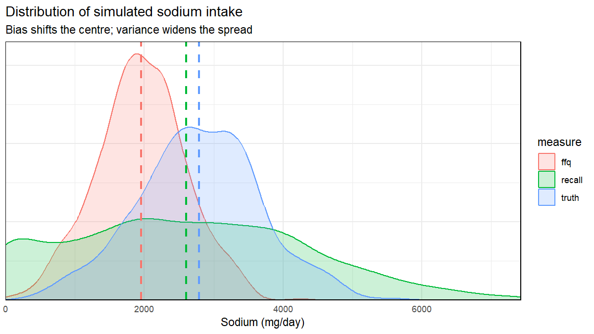
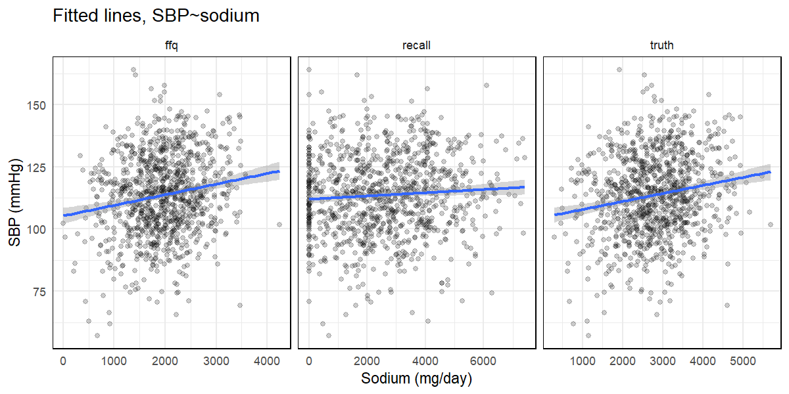
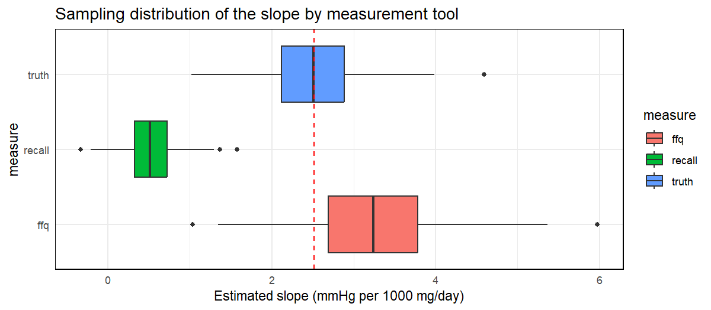

# Bias vs variance in dietary measurement: a simulation


- [Overview](#overview)
- [1. Simulate Data](#1-simulate-data)
  - [1. setup](#1-setup)
  - [2. PARAMETERS: usual intake](#2-parameters-usual-intake)
  - [3. PARAMETERS: blood pressure](#3-parameters-blood-pressure)
  - [4. PARAMETERS: effect of sodium on systolic blood
    pressure](#4-parameters-effect-of-sodium-on-systolic-blood-pressure)
  - [5. PARAMETERS: errors in recall and FFQ
    data](#5-parameters-errors-in-recall-and-ffq-data)
- [2. Simulate Studies](#2-simulate-studies)
  - [1. residual SD for SBP](#1-residual-sd-for-sbp)
  - [2. simulation function](#2-simulation-function)
  - [3. simulate one study](#3-simulate-one-study)
- [3. Describe Exposures](#3-describe-exposures)
  - [1. summary statistics](#1-summary-statistics)
  - [2. distributions](#2-distributions)
- [4. SBP ~ Sodium](#4-sbp--sodium)
  - [1. regression function](#1-regression-function)
  - [2. estimate the association, one
    study](#2-estimate-the-association-one-study)
  - [3. visualize the fitted lines](#3-visualize-the-fitted-lines)
  - [4. repeat the study many times](#4-repeat-the-study-many-times)
  - [5. summarise across studies](#5-summarise-across-studies)
  - [6. visualize the sampling
    distribution](#6-visualize-the-sampling-distribution)
- [Sources](#sources)

## Overview

The purpose of this brief tutorial is to expose students to various
important coding concepts in R/RStudio, while also giving an example of
the “bias/variance tradeoff” which is a core concept in many
introductory statistics courses in graduate school. The tutorial assumes
at least a novice background in R coding. It was not designed to be used
by students without the guidance and discussion of an advisor, as there
are several areas with important caveats and coding techniques that are
left out.

To first work through concepts of bias and variance, we will consider
two dietary assessment tools which are commonly used in epidemiological
studies of nutrition and health: food frequency questionnaires (FFQ) and
24-hour recalls (24HR). Details of these methods and their different
applications are beyond the scope of this tutorial. One potential error
a student may make in reviewing this tutorial is assuming that one
dietary intake method is **better** than another, or that we should just
choose one for a specific study. Neither is true. We have different
tools for different purposes, and often times the best methods combine
information from multiple intake tools. That, too, is beyond the scope
of this tutorial, which is primarily focused on bias and variance. [Here
is a good resource to start to learn more about dietary
assessment](https://epi.grants.cancer.gov/diet/usualintakes/).

In general, the FFQ and 24HR get intake wrong in different ways:

- **FFQ**: high bias, low variance. It asks about intake over a longer
  period, so day-to-day noise averages out, but it is systematically
  off.
- **24HR**: low bias, high variance. On average it is close to the
  truth, but any single day is a noisy picture of what someone usually
  eats.

In this tutorial, we simulate data on sodium intake and systolic blood
pressure (SBP), where we know the truth, and see what each type of error
does to (1) descriptions of intake and (2) the estimated association
between sodium and SBP.

Parameters come from Canadian data and published literature where
possible. In some places, for purposes of this tutorial, we make up some
data to help describe specific concepts. We explicitly state where data
comes from.

The tutorial is shown in X sections…

## 1. Simulate Data

In a simulation, **we set the truth**. That means we can measure exactly
how wrong each tool is, something we can never do with real data.

### 1. setup

Always make sure you have the correct libraries loaded.

``` r
library(here)
library(tidyverse)
```

### 2. PARAMETERS: usual intake

We pull usual sodium intake for Canadian adults from the [Canadian
Community Health Survey (CCHS) – Nutrition
2015](https://health.canada.ca/apps/open-information/sodium-potassium/Sodium-usual-intake-Canada-excl-territories-2015-en.csv),
published by Health Canada / Statistics Canada. These are *usual*
intakes: CCHS used repeat recalls and statistical modelling to strip out
day-to-day noise. So the spread in these data reflects **real
differences between people**, not measurement error. This will be our
“truth”.

The data were downloaded from the link above and saved in our `data`
folder. We read the saved file. The first line of the file is a title,
so we skip it. The file uses Latin-1 encoding, which we specify so
special characters display correctly.

``` r
# read CCHS data
raw_intake <- read_csv(here("data", "sodium_usual_intake_2015.csv"), skip=1, locale = locale(encoding = "latin1"))
```

Next, we isolate the measurements of interest: Canadian adults (19 years
and over), their mean intake, and an SD calculated from the 25th and
75th percentiles (explained below).

``` r
# isolate measurements of interest
intake <- raw_intake |>
  filter(Country=="Canada") |>  # remove data beyond the estimates (includes footnotes etc)
  filter(`Age or Life Stage Group` == "19 years and over") |> # only interested in total adult population, not age subgroups
  transmute(
    Sex,
    Mean,
    sd = (p75-p25) / 1.349 # explain why this number using qnorm(0.75) - qnorm(0.25)
  )
```

Let’s look at what we have.

``` r
intake
#> # A tibble: 3 × 3
#>   Sex         Mean    sd
#>   <chr>      <dbl> <dbl>
#> 1 Both sexes  2746  883.
#> 2 Males       3198  997.
#> 3 Females     2304  587.
```

Why 1.349? The table gives percentiles, not an SD. If intake is roughly
normal, the distance between the 25th and 75th percentiles is a fixed
number of SDs:

``` r
qnorm(0.75) - qnorm(0.25)
#> [1] 1.34898
```

So SD = (p75 − p25) / 1.349.

Finally, we pull the population mean and SD for both sexes combined.
These are the values we will simulate from.

``` r
# pull population mean (SD)
mean_sodium <- intake |> filter(Sex=="Both sexes") |> pull(Mean)
sd_sodium <- intake |> filter(Sex=="Both sexes") |> pull(sd)
```

Our “truth” is a mean of **2746 mg/day** with an SD of **883 mg/day**.

``` r
mean_sodium
#> [1] 2746
sd_sodium
#> [1] 882.8762
```

### 3. PARAMETERS: blood pressure

Average SBP among Canadian adults is from [Statistics
Canada](https://www150.statcan.gc.ca/n1/pub/82-625-x/2021001/article/00001-eng.htm).
We could not easily find a population SD, so we use an [NHANES
estimate](https://pmc.ncbi.nlm.nih.gov/articles/PMC10424908/) as a rough
guide. Noise in the **outcome** affects **precision** (wider CIs, less
power), but it does **not** bias the slope. Noise in the **exposure** is
a different story (see below).

``` r
mean_sbp <- 114 # mmHg
sd_sbp <- 16 # mmHg
```

### 4. PARAMETERS: effect of sodium on systolic blood pressure

Here we need data on how sodium impacts SBP. We use a large Cochrane
review, [He et al. BMJ
2013;346:f1325](https://www.bmj.com/content/346/bmj.f1325.short). From
the abstract:

> “A 100 mmol reduction in 24 hour urinary sodium (6 g/day salt) was
> associated with a fall in systolic blood pressure of 5.8 mm Hg (2.5 to
> 9.2, P=0.001) after adjustment for age, ethnic group, and blood
> pressure status.”

Now we have to convert from mmol to mg to align with the CCHS data:

- 1 mmol sodium = 23 mg
- 100 mmol (what He et al. use) = 2300 mg
- slope per 1000 mg: (5.8 / 2300) × 1000 = 2.52

This is our target: every tool below is trying to recover this number.

``` r
effect_sodium_sbp <- 2.52 # mmHg per 1000 mg/day
```

### 5. PARAMETERS: errors in recall and FFQ data

We rely primarily on [Freedman et al. Am J Epidemiol
2015;181:473–87](https://doi.org/10.1093/aje/kwu325), a pooled analysis
of 5 validation studies comparing self-reported sodium against 24-hour
urine (a recovery biomarker, our proxy for “truth”).

Two tools, two kinds of error. **Bias = how far off on average. Variance
= how scattered.**

#### Relative bias

How much of true intake each tool captures, on average (Freedman,
discussion p. 483: about 5–10% under-reporting for 24HR, about 30% for
FFQ). The recall has a small bias; the FFQ a large one.

``` r
relative_bias_recall <- 0.925 # 24HR gets about 92% of actual truth
relative_bias_ffq <- 0.7
```

#### Recall SD, from the attenuation factor

To get the SD of the recall error, we take the **attenuation factor
(AF)**, which is how much an association shrinks when using a recall
instead of the “truth”, and back-calculate. You can learn more about
attenuation [here](https://www.bmj.com/content/340/bmj.c2289.long).

In Freedman (p. 478 & Table 5), the AF for sodium measured with a single
24HR is ~0.2.

``` r
af_recall <- 0.2
```

Our recall is modelled as:

`recall = relative_bias_recall * truth + error`

Because of the scaling, the AF formula is:

    AF = cov(truth, recall) / var(recall)
       = relative_bias_recall * var(truth) / (relative_bias_recall^2 * var(truth) + var(error))

`var(truth)` is `sd_sodium^2`, so we can solve for `var(error)`:

    0.2 = relative_bias_recall * sd_sodium^2 / (relative_bias_recall^2 * sd_sodium^2 + var(error))
    relative_bias_recall^2 * sd_sodium^2 + var(error) = relative_bias_recall * sd_sodium^2 / 0.2
    var(error) = relative_bias_recall * sd_sodium^2 / 0.2 - relative_bias_recall^2 * sd_sodium^2

Note: if `relative_bias_recall = 1` (no proportional bias), this
simplifies to `var(error) = sd_sodium^2 / 0.2 - sd_sodium^2`.

Now we calculate it.

``` r
var_error <- relative_bias_recall * sd_sodium^2 / af_recall - relative_bias_recall^2 * sd_sodium^2
sd_recall <- sqrt(var_error)

sd_recall
#> [1] 1714.093
```

The recall’s random error has an SD of **1714 mg/day**, about **1.9×**
the real differences between people. This is the recall’s high variance.

#### FFQ SD (invented)

Finally, we invent a number for the SD of FFQs. In general, FFQs are
considered to have lower variance because they ask about foods consumed
over a longer period of time, theoretically averaging out day-to-day
fluctuations. For the purpose of the activity, we set a low SD to make
the lesson clear. In reality this number is probably not as low;
Freedman reports an AF of only ~0.1 for sodium FFQs.

``` r
sd_ffq <- 200
```

## 2. Simulate Studies

Now that we have our parameters, we can simulate a study.

### 1. residual SD for SBP

SBP = sodium part + residual. Independent parts add on the variance
scale, so we set the residual SD to keep total SBP SD at `sd_sbp`:

- `var(SBP) = (effect * sd_sodium/1000)^2 + var(resid)`
- sodium part SD = 2.52 × 883 / 1000 ≈ 2.2; total SBP variance = 16² =
  256
- sd_resid = √(256 − 4.95) ≈ 15.84

Sodium explains only **~2%** of the variation in SBP: a real but small
signal, easily buried by measurement error.

``` r
sd_resid <- sqrt(sd_sbp^2 - (effect_sodium_sbp * sd_sodium / 1000)^2)
sd_resid
#> [1] 15.84456
```

### 2. simulation function

Here we write a function that simulates true intake, SBP, and measured
values from recalls and FFQs for `n` people. We set a floor of 0 on the
measured values, since intake cannot be negative.

``` r
simulate_study <- function(n){
  tibble(
    truth = rnorm(n, mean_sodium, sd_sodium), # true usual intake
    sbp = mean_sbp + effect_sodium_sbp*(truth - mean_sodium)/1000 + rnorm(n, 0, sd_resid), # outcome
    # here we simulate measured values from recalls and ffqs, and we set a floor of 0 (cannot have negative intake)
    recall = pmax(relative_bias_recall * truth + rnorm(n, 0, sd_recall), 0),
    ffq = pmax(relative_bias_ffq * truth + rnorm(n, 0, sd_ffq), 0)
  )
}
```

### 3. simulate one study

We set a seed so the results are reproducible, choose a study size, and
run the function once.

``` r
set.seed(12345)
n <- 1000 # 1000 people in the study, for example
study <- simulate_study(n)
```

Each row is one person, with their **true** intake and what a **recall**
and an **FFQ** would say.

``` r
study
#> # A tibble: 1,000 × 4
#>    truth   sbp recall   ffq
#>    <dbl> <dbl>  <dbl> <dbl>
#>  1 3263. 142.   1976. 2386.
#>  2 3372. 117.   4964. 2218.
#>  3 2649. 100.   1463. 1774.
#>  4 2346. 101.   4053. 1639.
#>  5 3281. 109.   5447. 2517.
#>  6 1141.  79.9  1118.  990.
#>  7 3302. 114.   6352. 2201.
#>  8 2502.  97.1   163. 1659.
#>  9 2495. 124.    256. 1837.
#> 10 1934. 106.      0  1114.
#> # ℹ 990 more rows
```

## 3. Describe Exposures

### 1. summary statistics

We reshape the data so each measure is a group, then summarise each one.
`r_truth` is the correlation of each measure with the true intake.

``` r
study |>
  pivot_longer(
    c(truth, recall, ffq),
    names_to = "measure",
    values_to = "sodium"
  ) |>
  summarise(
    mean = mean(sodium),
    sd = sd(sodium),
    median = median(sodium),
    p25 = quantile(sodium, 0.25),
    p75 = quantile(sodium, 0.75),
    r_truth = cor(sodium, study$truth),
    .by = measure
  )
#> # A tibble: 3 × 7
#>   measure  mean    sd median   p25   p75 r_truth
#>   <chr>   <dbl> <dbl>  <dbl> <dbl> <dbl>   <dbl>
#> 1 truth   2787.  882.  2787. 2220. 3354.   1    
#> 2 recall  2600. 1699.  2544. 1275. 3848.   0.430
#> 3 ffq     1954.  641.  1963. 1542. 2363.   0.955
```

- **Recall:** mean of **2600** vs **2787** for the truth (7% low), but
  an SD of **1699**, about **1.9×** wider. Correlation with truth:
  **0.43**.
- **FFQ:** mean of **1954** (30% low) with an SD of **641**, *narrower*
  than the truth. Correlation with truth: **0.95**.

### 2. distributions

Plotting the distributions makes the difference clear: bias shifts the
centre, variance widens the spread. Dashed lines are the means. Note
that **narrow ≠ accurate**: the FFQ looks precise partly because its
bias squeezes everyone into a smaller range.

``` r
study |>
  pivot_longer(
    c(truth, recall, ffq),
    names_to = "measure",
    values_to = "sodium"
  ) |>
  ggplot(
    aes(sodium, colour = measure, fill = measure)
  )+
  geom_density(alpha = 0.2) +
  geom_vline(
    data = \(d) summarise(d, mean = mean(sodium), .by = measure),
    aes(xintercept = mean, colour = measure),
    linetype = 2, linewidth = 1,
    show.legend = FALSE
  ) +
  scale_x_continuous(expand = c(0,0)) +
  scale_y_continuous(expand = expansion(mult = c(0, 0.05))) +
  labs(
    x = "Sodium (mg/day)",
    title = "Distribution of simulated sodium intake",
    subtitle = "Bias shifts the centre; variance widens the spread"
  ) +
  theme_minimal() +
  theme(
    axis.title.y = element_blank(),
    axis.text.y = element_blank(),
    panel.border = element_rect(colour = "black", fill=NA)
  )
```



## 4. SBP ~ Sodium

Now we regress SBP on sodium using each of the three measures. The true
slope is **2.52 mmHg per 1000 mg/day**.

### 1. regression function

This function fits the regression for one measure and returns the slope,
its SE, and p-value.

``` r
# regression
fit_slope <- function(data, measure){
  x <- data[[measure]]/1000 # mmHg per 1000 mg/day
  fit <- lm(data$sbp ~ x) # regression, systolic blood pressure and sodium (for each of the three measures)
  s <- summary(fit)$coefficients[2, ]

  tibble(
    measure,
    est = s[[1]],
    se = s[[2]],
    p = s[[4]]
  )
}
```

### 2. estimate the association, one study

We apply the function to each measure in our single study and add 95%
CIs.

``` r
# results
map_dfr(c("truth", "recall", "ffq"), \(m) fit_slope(study, m)) |>
  mutate(lo = est-1.96*se, hi = est+1.96*se)
#> # A tibble: 3 × 6
#>   measure   est    se            p     lo    hi
#>   <chr>   <dbl> <dbl>        <dbl>  <dbl> <dbl>
#> 1 truth   3.22  0.573 0.0000000244 2.10    4.35
#> 2 recall  0.648 0.301 0.0317       0.0576  1.24
#> 3 ffq     4.26  0.789 0.0000000824 2.72    5.81
```

Same people, same blood pressures, three answers:

- **Truth:** 3.22. Even the truth misses in a single study; that’s
  ordinary sampling variation, and why we repeat the study below.
- **Recall:** **0.65**, shrunk toward zero. Random error in the exposure
  *flattens* the association (attenuation).
- **FFQ:** **4.26**, too steep. The FFQ squeezes intake into a smaller
  range, so the same rise in SBP is spread over fewer mg.

### 3. visualize the fitted lines

``` r
# visualize lm line
study |>
  pivot_longer(c(truth, recall, ffq), names_to = "measure", values_to = "sodium") |>
  ggplot(aes(sodium, sbp)) +
  geom_point(alpha = 0.2) +
  geom_smooth(method = "lm") +
  facet_wrap(~measure, scales = "free_x") +
  labs(
    x = "Sodium (mg/day)",
    y = "SBP (mmHg)",
    title = "Fitted lines, SBP~sodium"
  ) +
  theme_minimal() +
  theme(
    panel.border = element_rect(colour = "black", fill=NA)
  )
```



### 4. repeat the study many times

One study can mislead, so we repeat the whole study many times and look
at how the estimated slope behaves for each tool. First, we set the
number of simulated studies.

``` r
n_sims <- 500
```

Then we simulate a new study and estimate the slope for each measure,
`n_sims` times.

``` r
sims <- map_dfr(1:n_sims, \(i){
  d <- simulate_study(n)
  map_dfr(c("truth", "recall", "ffq"), \(m) fit_slope(d, m)) |> mutate(sim = i)
})
```

### 5. summarise across studies

For each measure we calculate:

- **bias**: systematic error in the slope
- **emp_se**: spread of the slope across studies
- **rmse**: bias and variance combined
- **coverage**: % of 95% CIs containing the truth
- **power**: % of studies detecting the effect

``` r
sims |>
  group_by(measure) |>
  summarise(
    mean_est = mean(est),
    bias = mean(est) - effect_sodium_sbp, # systematic error in the slope
    emp_se = sd(est), # spread of the slope across studies
    rmse     = sqrt(mean((est - effect_sodium_sbp)^2)), # bias and variance combined
    coverage = mean(abs(est - effect_sodium_sbp) <= 1.96 * se),  # % of 95% CIs containing the truth
    power    = mean(p < 0.05) # % of studies detecting the effect
  )
#> # A tibble: 3 × 7
#>   measure mean_est    bias emp_se  rmse coverage power
#>   <chr>      <dbl>   <dbl>  <dbl> <dbl>    <dbl> <dbl>
#> 1 ffq        3.24   0.720   0.777 1.06     0.836 0.988
#> 2 recall     0.520 -2.00    0.294 2.02     0     0.422
#> 3 truth      2.50  -0.0150  0.556 0.556    0.958 0.998
```

Across **500** simulated studies:

- **Recall (low bias, high variance):** average slope **0.52**, about
  **21%** of the truth, matching the attenuation factor of 0.2. Its CIs
  contain the truth **0%** of the time, and only **42%** of studies
  detect the effect.
- **FFQ (high bias, low variance):** average slope **3.24**, about **29%
  too high**. CI coverage **84%**.

### 6. visualize the sampling distribution

The red line is the true slope. **Neither error is harmless, and they
push the slope in opposite directions.** A bigger study shrinks the
spread of the estimates, but not the bias.

``` r
sims |>
  ggplot(
    aes(measure, est, fill = measure)
  ) +
  geom_boxplot() +
  geom_hline(yintercept = effect_sodium_sbp, linetype = 2, colour = "red") +
  labs(
    y = "Estimated slope (mmHg per 1000 mg/day)",
    title = "Sampling distribution of the slope by measurement tool"
  ) +
  coord_flip()+
  theme_minimal() +
  theme(
    panel.border = element_rect(colour = "black", fill=NA)
  )
```



## Sources

| Parameter | Value | Source |
|----|----|----|
| `mean_sodium`, `sd_sodium` | 2746, 883 mg/day | [CCHS – Nutrition 2015, usual sodium intake](https://health.canada.ca/apps/open-information/sodium-potassium/Sodium-usual-intake-Canada-excl-territories-2015-en.csv) (19 years and over, both sexes) |
| `mean_sbp` | 114 mmHg | [Statistics Canada](https://www150.statcan.gc.ca/n1/pub/82-625-x/2021001/article/00001-eng.htm) |
| `sd_sbp` | 16 mmHg | [NHANES estimate](https://pmc.ncbi.nlm.nih.gov/articles/PMC10424908/) |
| `effect_sodium_sbp` | 2.52 mmHg per 1000 mg/day | [He et al. BMJ 2013](https://www.bmj.com/content/346/bmj.f1325.short), abstract (converted from per 100 mmol) |
| `relative_bias_recall`, `relative_bias_ffq` | 0.925, 0.7 | [Freedman et al. 2015](https://doi.org/10.1093/aje/kwu325), p. 483 |
| `af_recall` | 0.2 (gives `sd_recall` = 1714 mg/day) | [Freedman et al. 2015](https://doi.org/10.1093/aje/kwu325), p. 478 & Table 5; background on attenuation: [Hutcheon et al. BMJ 2010](https://www.bmj.com/content/340/bmj.c2289.long) |
| `sd_ffq` | 200 mg/day | invented for teaching |
